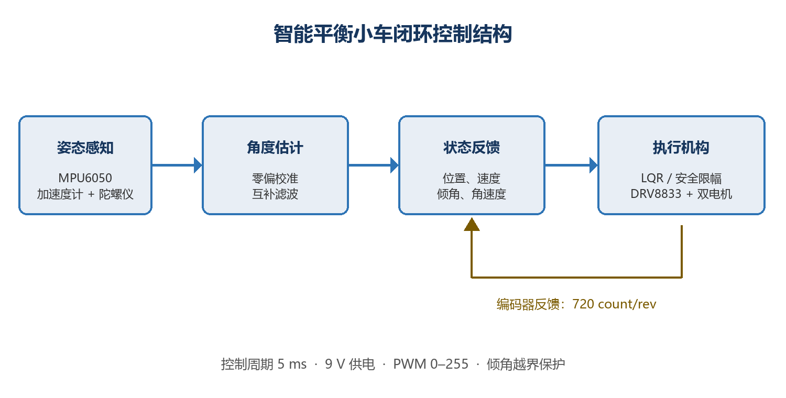

# Two-Wheel Balance Car (WIP)

> 临时作品页 / Temporary portfolio page. 基于 Arduino Mega 2560 双轮平衡平台的参考模型与实验代码，本人调参与改进仍在补充中。

## 中文

### 简介
本仓库整理了一套 **Arduino Mega 2560 + MATLAB/Simulink** 的两轮平衡小车相关模型与驱动代码，覆盖从 PWM、编码器、IMU，到电机 PI 控制与姿态互补滤波的完整链路。

当前版本以平台参考代码与模型为主，作为作品集临时链接；个人调参记录、对比实验与后续改进会持续追加，**不声称独立设计整套硬件或独立编写全部控制代码**。

### 硬件（平台侧）
- 主控：Arduino Mega 2560
- 电机驱动：DRV8833（双 PWM）
- 传感器：MPU6050（陀螺仪 + 加速度计）、HMC5883L（磁力计）
- 编码器：正交编码约 **720 count/rev**
- 供电参考：约 **9 V**；PWM 范围 **0–255**

### 控制要点
- **电机**：开环增益估计 → 位置 **P / PI** 闭环；真实环境模型中考虑电源饱和、离散步长、编码器/PWM 量化与一步延迟
- **姿态**：陀螺仪短时动态 + 加速度计长期基准，采用互补滤波形式  
  `θ[k] = α·θ_gyro[k] + (1-α)·θ_acc[k]`（参考设置常见为 α≈0.9）
- **平衡演示**：`11_balance_demo` 中含完整 Simulink 模型与生成的 C 源码（含平台参考参数文件）

### 模块目录
| 目录 | 内容 |
|------|------|
| `01_pwm` | LED / PWM 调光 |
| `02_adc_encoder` | ADC 映射与编码器 |
| `03_imu_gyro` | MPU6050 I2C |
| `04_compass` | 磁力计与航向 |
| `05_serial` | 串口多字节传输与捕获 |
| `06_bluetooth` | 蓝牙串口采集 |
| `07_motor_response` | 电机阶跃响应 |
| `08_motor_control` | 开环预测与闭环 P/PI |
| `09_realistic_pi` | 含饱和与量化的速度 PI |
| `10_angle_fusion` | 互补滤波姿态估计 |
| `11_balance_demo` | 平衡演示模型与生成代码 |
| `docs/figures` | 结构图与实验相关截图 |

### 如何运行
1. 安装 MATLAB/Simulink 与 Arduino 硬件支持包，连接 Mega 2560。
2. 打开对应目录下的 `.slx` 模型，选择 **External** 或 **Deploy to Hardware**。
3. 按模型中的引脚说明接好电机驱动、编码器与 MPU6050（I2C）。
4. 串口/蓝牙模块用于数据回传时，注意与 External 模式共用串口 0 的冲突。
5. 平衡演示请先阅读 `11_balance_demo/NXT_Parameters.m` 中的平台参数与安全限幅说明，再上电调试。

### 关于「我的调参」
翻阅现有书面记录后，**未能提取到可独立核验的个人实测改参数值**（例如本人最终敲定的 Kp/Ki、互补滤波 α、或可复现的实测波形对比）。仓库中出现的部分曲线与参数表来自平台参考资料，因此本页暂不单列「我的调参」结果，避免把参考值写成个人成果。

后续计划补充：
- 本人重新整定的 PI / 滤波参数与前后对比图
- 实测串口/MATLAB 原始数据
- 平衡站立稳定性说明

**Status: Work in progress.**

---

## English

### Overview
This repository packages **Arduino Mega 2560 + MATLAB/Simulink** models for a two-wheel balancing platform: PWM, encoder, IMU, motor PI control, and complementary-filter tilt estimation.

The current snapshot is mainly **reference platform code/models**, published as a temporary portfolio link. Personal tuning notes and improvements will be added later. It does **not** claim sole hardware design or sole authorship of all control software.

### Hardware
- MCU: Arduino Mega 2560
- Driver: DRV8833 (dual PWM)
- Sensors: MPU6050, HMC5883L
- Encoder: ~720 count/rev
- Supply / PWM: ~9 V, PWM 0–255

### Control
- Motor: open-loop gain estimate → position **P/PI**; realistic model adds saturation, sampling, quantization, and one-step delay
- Attitude: complementary filter combining gyro and accelerometer
- Balance demo models live under `11_balance_demo/`

### How to run
Install MATLAB/Simulink Arduino support, open a `.slx` in the module folders, wire the board as noted in the model, and run External mode or Deploy. Mind Serial0 conflicts when capturing data. Read `NXT_Parameters.m` before running the balance demo.

### Personal tuning
No independently verifiable personal gain/filter values were found in the available write-ups, so a dedicated “My tuning work” section is omitted for now (WIP).

---

## License / attribution
Platform models, S-functions, and generated sources come from the original balancing-platform package used for practice. Keep that attribution when you reuse them. This portfolio packaging does not assert exclusive copyright over the reference code.
